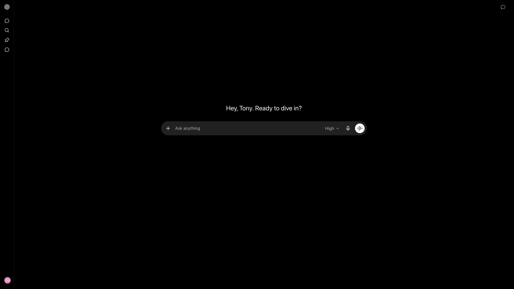
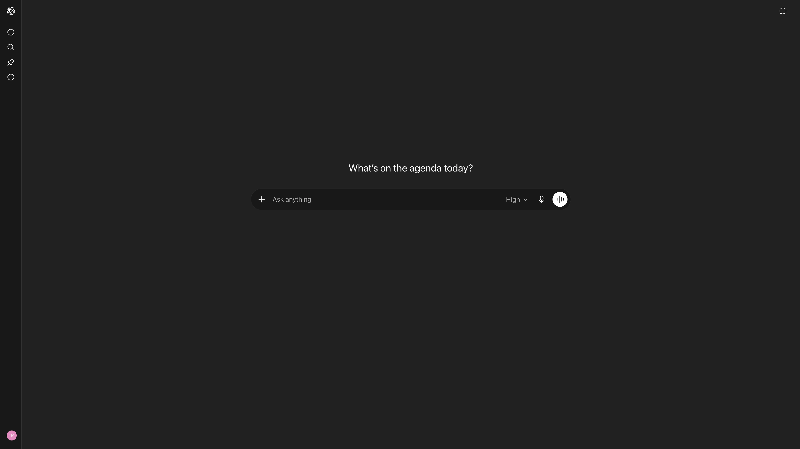
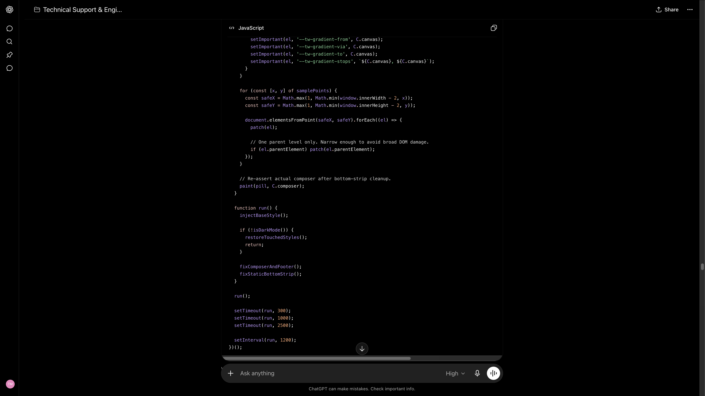
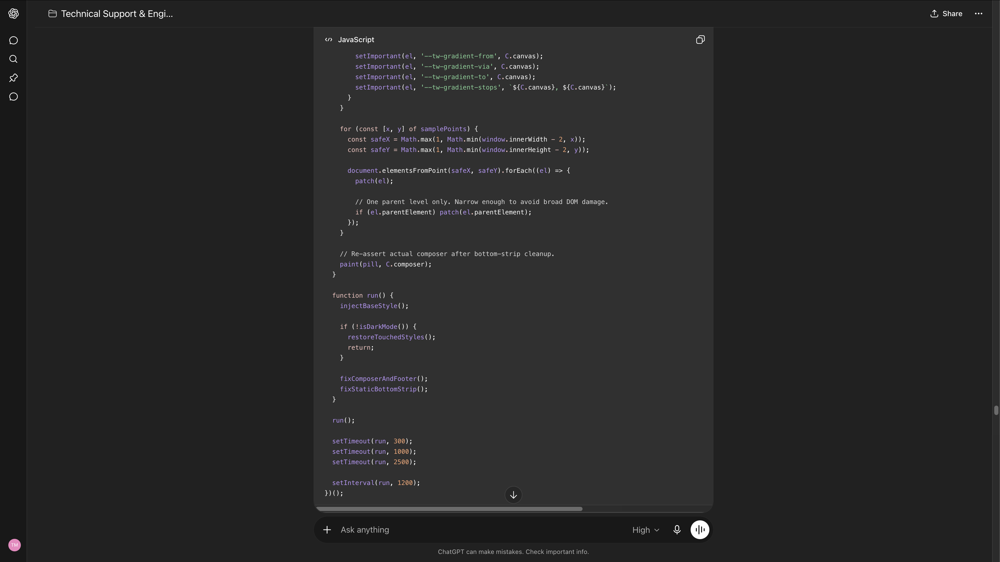
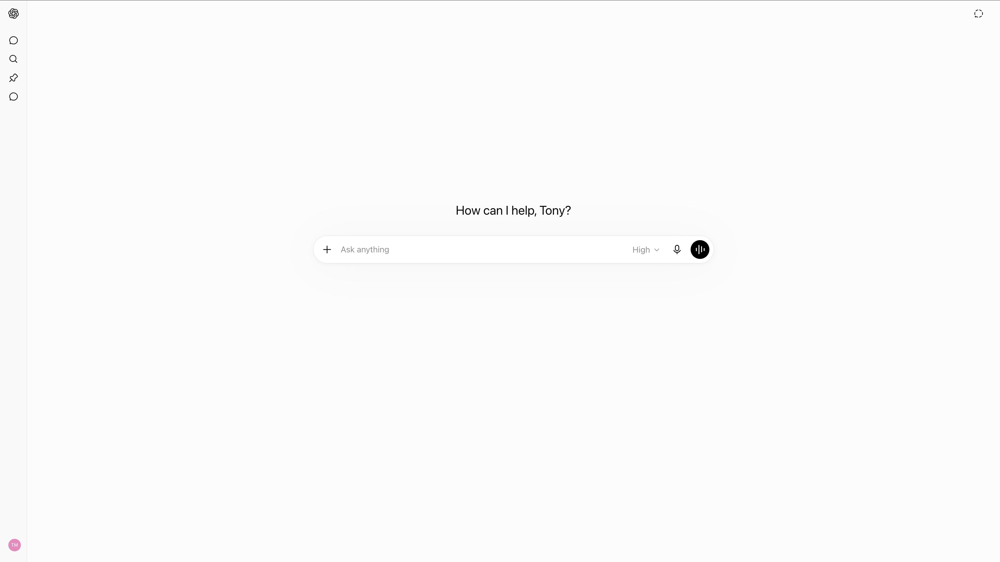

# ChatGPT Dark Mode Charcoal Palette Restore

Restores ChatGPT’s original charcoal dark palette with a matched composer, canvas, sidebar, message bubbles, code blocks, and bottom dock.

This userscript is for people who prefer the original, more visually separated ChatGPT interface instead of the flatter, lighter dark theme.

## What it fixes

- Restores the original charcoal main canvas
- Matches the composer/input bar to the original official-style surface
- Keeps the sidebar properly separated
- Restores readable lifted message bubbles
- Restores contrast for code and copy blocks
- Removes the pure-black header capsules introduced by newer UI changes
- Cleans up the bottom dock and disclaimer halo
- Preserves light mode
- Avoids broad DOM repainting that causes blocky UI artifacts

## Preview

### Before — Home Page



### After — Home Page



### Before — Chat Page



### After — Chat Page



### Light Mode Unaffected



## Install

### Option 1: Install from Greasy Fork

[Install ChatGPT Dark Mode Charcoal Palette Restore](https://greasyfork.org/en/scripts/583978-chatgpt-dark-mode-charcoal-palette-restore)

### Option 2: Install manually from GitHub

1. Install a userscript manager:

   - Tampermonkey
   - Violentmonkey

2. Open the script file in this repository:

   ```text
   ChatGPT_DarkMode_Charcoal_Palette_Restore.user.js
   ```

3. Click **Raw**.

4. Your userscript manager should detect the script and offer to install it.

5. Open ChatGPT and enable dark mode.

## Supported sites

```text
https://chatgpt.com/*
https://chat.openai.com/*
```

## Browser support

Tested with:

```text
Chrome + Tampermonkey
```

It should also work with other Chromium-based browsers and Violentmonkey, but Chrome with Tampermonkey is the primary tested configuration.

## Privacy

This script does not collect data.

It does not:

- read or store your conversations
- send network requests
- access external servers
- modify ChatGPT functionality
- track usage
- use analytics

It only applies local visual styling to ChatGPT pages.

## How it works

Version 4.0.4 uses ChatGPT’s current semantic UI hooks and internal design tokens instead of repeatedly scanning or repainting the page.

1. **Theme variable overrides**  
   Restores the charcoal canvas, darker sidebar, lifted message surfaces, and composer colors through ChatGPT’s own design tokens.

2. **Semantic UI targeting**  
   Uses semantic sidebar, composer, user-message, code-block, rich-response, and settings hooks rather than fragile geometry detection.

3. **Independent code-block contrast**  
   Styles the code-block surface independently so it remains visually raised without changing the darker composer.

4. **Dark-mode-only CSS**  
   Resolved dark-mode overrides target `html[data-theme='dark']`. Early startup canvas rules also honor the native dark preference or a dark OS while the theme is unresolved; explicit light preferences and resolved light mode remain unaffected.

The script uses one persistent stylesheet. If the document root is absent at startup, a temporary observer waits for it and disconnects before stylesheet insertion. There are no ongoing observers, recurring DOM scans, or repaint intervals.

## Why this exists

Recent ChatGPT UI changes made dark mode feel flatter and less visually separated. This script restores the original charcoal palette while keeping the interface clean and usable.

## Troubleshooting

### Brief white flash before dark mode appears (Chrome + Tampermonkey)

A userscript cannot style a frame displayed before the userscript manager executes it. Version 4.0.4 requests `document-start` and installs its stylesheet as soon as the document root is available, but the manager's injection mode still matters.

According to [Tampermonkey's Content Script API documentation](https://www.tampermonkey.net/documentation.php?locale=en&q=content_script_api), **Content Script** and **UserScripts API** on Chrome retrieve userscripts through background messaging and do not provide true `document-start` support. **UserScripts API Dynamic** supports `document-start`.

If you see a brief white flash, try this reversible timing test:

1. Open **Tampermonkey Dashboard → Settings**. If the option is hidden, **Config mode → Advanced** exposes additional settings.
2. Record the current **Security → Content Script API** value.
3. Select **UserScripts API Dynamic** and save.
4. Test several fresh ChatGPT tabs, reloads, and the transitions that previously flashed. Keep the script on version **4.0.4 or later**.

This is an **extension-wide setting** and affects other Tampermonkey userscripts too. Restore the recorded value if needed.

Late injection is a possible cause, not a confirmed explanation for every white flash. If the flash persists, report your Chrome and Tampermonkey versions, script version, selected API mode, and whether it occurs on a new tab, reload, or in-app navigation.

### The script does nothing

Check that:

- your userscript manager is enabled
- the script itself is enabled
- ChatGPT is set to dark mode
- the site match includes `chatgpt.com`
- your browser allows the userscript manager to run on ChatGPT

### Light mode looks wrong

Current releases follow the native dark-mode attributes and respect explicit or resolved light mode.

Disable older copies or beta versions of the script, make sure only the current release is enabled, and hard-refresh the page.

### ChatGPT updates broke the style

ChatGPT’s interface changes frequently. If the layout changes and the script breaks, open an issue and include:

- browser
- userscript manager
- screenshot
- what changed
- whether it happens on the home page, chat page, or both

## Development notes

```text
Do:
- prefer ChatGPT design tokens
- use semantic IDs, attributes, and test hooks
- keep code-block and composer surfaces independent
- scope visual overrides to native dark-mode hooks
- respect explicit light preferences and resolved light mode during startup

Avoid:
- geometry-based DOM scanning
- recurring repaint intervals
- broad main, form, or textarea overrides
- manual code-block wrapper traversal
- MutationObserver repaint loops
```

## License

MIT License.

## Disclaimer

This project is not affiliated with, endorsed by, or sponsored by OpenAI.

ChatGPT is a product of OpenAI. This is an independent visual userscript.
